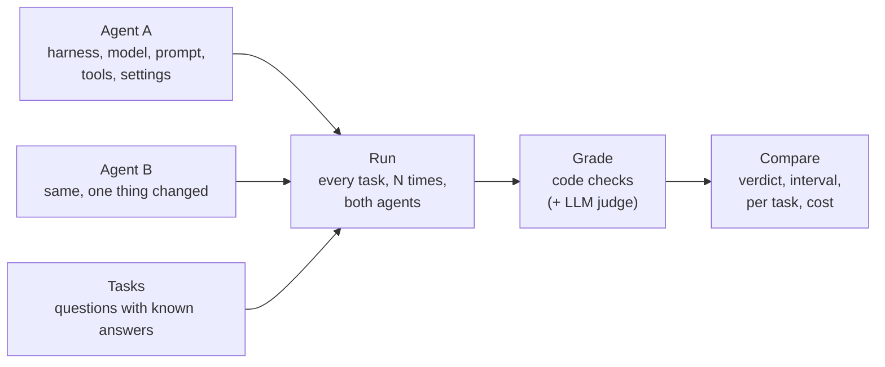
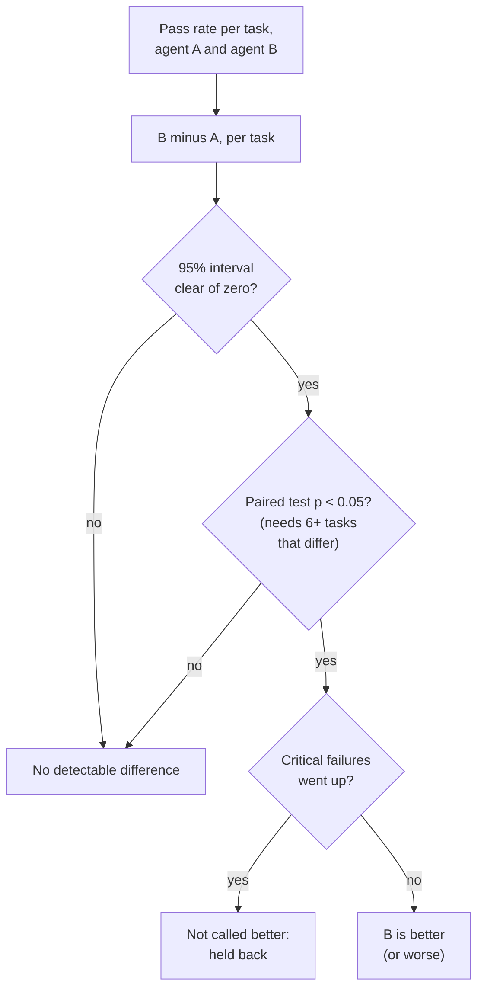
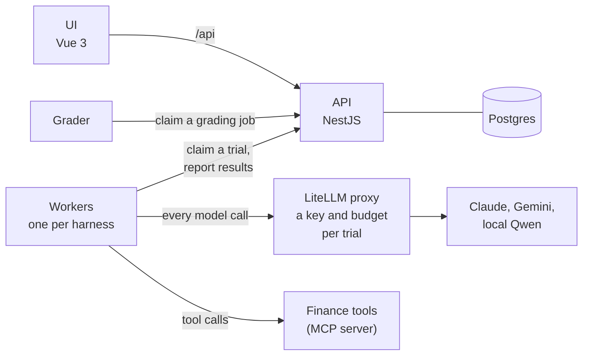

# Agent Evals

Runs two versions of an agent on the same tasks, many times each, and tells you whether the change
made it better, worse or no different, and how sure that is. Deterministic checks first, an LLM
judge for what code can't decide, calibrated against my own hand labels. Every trial's full trace
is one click away.

Video walkthrough (8 min): _link to add_



## Try it

```bash
docker compose up -d --build --wait
```

Open http://127.0.0.1:8080 and click **See a finished example**. No key needed, nothing spent.

You get a real 400-trial experiment: the verdict, each task's results, and every trial's trace
(messages, tool calls, and what the grader decided and why). First build takes about 5 minutes and
uses about 10 GB of disk (have 15 GB free).

## Results

All on Hermes Agent with Claude Haiku 5.5. Each plan and its predictions were committed before the
run. Anything I changed after is listed as a deviation in
[`docs/experiment.md`](docs/experiment.md).

| Change | Result | What it means |
| --- | --- | --- |
| Planted one bad prompt line: "answer from your own knowledge to keep replies fast" | Fixed prompt +28 points (+9 to +49), p = 0.047 | Caught. 3 tasks flagged, all ones I predicted |
| Removed the calculator tools | +45 points with them (+24 to +66), p = 0.001 | Caught |
| Added a document search tool (a bank's current rates, this year's tax slabs) | +56 points with it (+34 to +77), p = 0.002 | Caught. A control built to be caught: the bank is fictional, so only the tool knows its rates. Without it the agent made up a rate or fee in 42 of 100 trials (counted after a grader fix and regrade, listed as a deviation) |
| Nothing: the same agent on both sides | −4 points (−12 to +3) | No false alarm |
| My actual prompt fix, v1 to v2 | +9 points (+3 to +16), p = 0.0625 | Not enough tasks to call it |

The last row is the one that matters. v2 probably passes more often, mostly by following the
sourcing rule (What I'd trust least, below). But 4 of the 10 tasks always passed
and 1 always failed, in both versions, so only 5 tasks could show a difference. With 5, the test
can't get under p = 0.05 however big the gap. The fix is more tasks in the middle, not more trials.

Every run together cost about $35 in model calls ([`docs/cost.md`](docs/cost.md)).

## How the verdict works

The task is the unit, not the trial. Ten trials of one task aren't ten independent data points: an
easy task passes whatever the prompt says. So each task is compared with itself across the two
agents, and the stats run over tasks.



The interval comes from resampling tasks, the paired test is a sign-flip test, and per-task flags get a
multiple-comparison correction. Details in [`docs/design.md`](docs/design.md), section 6.

## How it works



- Five harnesses behind one adapter contract: Hermes Agent (pinned commit), LangGraph, Google ADK,
  the OpenAI Agents SDK, and a plain tool-calling loop as the baseline.
- Every model call goes through LiteLLM. Each trial gets its own key and budget, and spend, tokens
  and latency come from LiteLLM's records, not estimates. Response cache is off, so repeated trials
  are real samples.
- Each trial runs in a fresh folder on a network that only reaches the API, LiteLLM and the fake
  model server. If a worker dies mid-trial, the trial is re-run and its spend still counts.
- Grading is its own step. A grader fix means a regrade, not a re-run.
- An LLM judge grades what code can't, like whether the advice fits this client. It's calibrated on
  my hand labels: tuned on about 30 discovery trials I labelled, then checked once against 40
  held-out trials I labelled blind. A judge criterion counts in a verdict once it agrees with me
  well enough (kappa at least 0.6, and no lean towards either version). The current judge didn't:
  on the 40 held-out trials it passed all 9 answers I failed. So it doesn't count. Its verdicts on
  those 40 are in `judge-panel/`; the shipped examples were never judged, so their trial pages say
  "Not judged". Details: [`docs/judge-validation.md`](docs/judge-validation.md).
- The tasks are a personal-finance assistant for clients in India: calculator tools, client files,
  and a simulated client for the multi-turn ones. 31 tasks: 10 held out for scoring, 11 for
  discovery (where v1's failures were found), 10 for retrieval.

## Running it for real

Without a key you can open the examples, build and save an agent, preview exactly what reaches the
model, and run on fake models (`fake/...`). A fake run tests the platform, not an agent. It makes
the same scripted calls whatever the task, so most of its trials fail. That's expected.

With a key:

1. Copy `.env.example` to `.env`.
2. Add `ANTHROPIC_API_KEY` and/or `GEMINI_API_KEY`. If a Claude key came with my submission email,
   it goes in `ANTHROPIC_API_KEY`. It's capped at $10 and revoked after the review.
3. Run `docker compose up -d` again.

Every run shows its trials, models and worst-case cost before it starts, and asks you to confirm.
A Hermes run first checks your prompt against Hermes's own instructions (one call, about 3 cents)
and shows what clashes.

Stop it with `docker compose down`. Add `-v` to wipe the database too.

<details>
<summary>Ports taken, a second checkout, disk and cleanup</summary>

- Port taken: set `UI_PORT`, `API_PORT` or `LITELLM_PORT`, e.g.
  `API_PORT=3001 docker compose up -d --build --wait`. Use the same variables for every later
  `docker compose` command and for the checks under Tests.
- A second checkout on the same machine needs its own project name, ports and image tag
  (`docker compose -p review`, `EVALS_IMAGE_TAG=review` in its `.env`). Otherwise its build
  replaces the first one's images.
- Disk: a cold build used about 9.9 GB in testing. Opening all eight shipped examples writes about
  514 MB of trial files into `runs/`.
- `down -v` doesn't touch files on disk: trial files in `./runs/`, labels in `./labels/`, prompt
  versions you saved in `configs/prompts/`. Clear trial files with `rm -rf runs/*` (not the folder
  itself). No sudo needed, the API makes those folders group-writable. If `rm` is still refused (a
  folder Docker created as root), run `docker compose exec api sh -c 'rm -rf /runs/*'`.
- API container unhealthy: `docker compose logs api` says why (database down, or a folder it can't
  write) and how to fix it.

</details>

## Extending it

### A harness

One folder under `workers/` and one service block in `docker-compose.yml`. You write two methods,
`setup(ctx)` and `run_turn(ctx, history, max_steps)`; the shared library does the rest. Nothing in
the platform core changes.

<details>
<summary>Steps</summary>

```bash
make new-harness NAME=crewai      # scaffold workers/crewai/ and print its compose service
make probe-harness NAME=crewai    # see what actually reaches the model, against the fake server
make test-harness NAME=crewai     # the contract's gate tests
```

`setup(ctx)` maps our settings to the harness's own; `run_turn` is one agent turn. The shared
library handles the spec, timeout, tools, simulated client, result and trace. The five adapters here
are 300 to 420 lines each. Contract: [`docs/adapter-contract.md`](docs/adapter-contract.md). How
each harness was wrapped: [`docs/harness-guide.md`](docs/harness-guide.md).

</details>

### A model

One entry in `services/litellm/config.yaml`: provider route, key variable, prices. A local
open-weight model (Qwen 2.5 7B through Ollama) is already registered.

<details>
<summary>Steps</summary>

1. Add one entry to `services/litellm/config.yaml`: provider route, the key's variable name, prices.
2. A new provider also needs its key passed to LiteLLM: add the variable to the `litellm` service
   in `docker-compose.yml` and its name to `.env.example`. For the UI to warn when it's missing,
   add it to `PROVIDER_KEYS` in `apps/api/src/common/app-config.ts`.
3. If the model refuses a setting (a 400 on a real run), add it to `MODEL_REJECTS` in
   `apps/api/src/configs/settings.ts`, like Haiku 5.5's `temperature`.
4. Check it:

```bash
uv run --no-project --with pyyaml==6.0.3 python scripts/check_litellm_config.py   # no cache, prices set
docker compose restart litellm
```

A local open-weight model is already registered: `qwen2.5-7b-local`, through Ollama. Start it with
`docker compose --profile local-model up -d ollama`, pull it once with
`docker compose exec ollama ollama pull qwen2.5:7b` (about 4.7 GB), and pick it in a config. Free,
but slow on a CPU: minutes per call.

</details>

### A task

One folder `tasks/<id>/` with a `task.json`: the messages (or a simulated client), the client's data
file if there is one, and the graders. The API picks it up without a restart.

<details>
<summary>Graders and examples</summary>

Graders can check an exact number from a tool, whether a tool was called, text present or absent,
the end state, where every number came from, a Python unit test, or ask the LLM judge with a rubric.

- Short hand-written example: `tasks/demo-skill-card-transfer/task.json`.
- Fields: [`docs/api-contract.md`](docs/api-contract.md) (Task file). Graders:
  [`docs/proposals/grader-format.md`](docs/proposals/grader-format.md).
- Don't name a hand-written task `draft-*`. `scripts/make_draft_tasks.py` writes those folders and
  overwrites hand edits.

</details>

## Tests

You need Node 22.14+, pnpm 10.34.9 (`corepack enable` once) and [uv](https://docs.astral.sh/uv/).
No test calls a real model. They all use the fake model server.

```bash
pnpm install && pnpm lint && pnpm typecheck && pnpm test && pnpm build   # API and UI
cd graders && uv sync --locked && uv run pytest -q                        # graders and the judge
cd stats && uv sync --locked && uv run pytest -q                          # judge agreement maths
cd workers/adapterlib && uv sync --locked && uv run pytest -q             # contract, runner
cd services/finance-mcp && uv sync --locked && uv run pytest -q           # the finance tools
cd services/fake-llm && uv sync --locked && uv run pytest -q              # the fake model server
make test-harness NAME=ownloop                                            # one harness's gate tests
scripts/setup_hermes.sh && make test-harness NAME=hermes                  # Hermes needs its pinned checkout first
python3 scripts/smoke.py                                                  # the running stack, end to end
docker compose --profile smoke run --rm netcheck                          # worker isolation
python3 scripts/sp3_kill_test.py --n 2                                    # kill a worker mid-run, every trial still runs once
```

<details>
<summary>The API's database tests, and a stack on other ports</summary>

Without `TEST_DATABASE_URL`, `pnpm test` skips the API's database suites. The only sign is the
skipped count in Jest's summary (`16 skipped, 38 passed`). CI runs them against Postgres. Locally,
use a throwaway Postgres, never the compose one:

```bash
docker run --rm -d --name evals-api-test -p 127.0.0.1:55432:5432 -e POSTGRES_PASSWORD=x postgres:17
TEST_DATABASE_URL=postgresql://postgres:x@127.0.0.1:55432/postgres pnpm test
docker stop evals-api-test
```

A stack on other ports needs the same settings for the checks:
`API_PORT=3001 python3 scripts/smoke.py` and
`API_PORT=3001 docker compose --profile smoke run --rm netcheck` (otherwise compose recreates the
API on its default port). With `-p <name>` or `COMPOSE_PROJECT_NAME`, use the same for both.

Isolation between trials, on the built images (about 3 minutes):
`cd workers/adapterlib && EVALS_IMAGE_TESTS=1 uv run pytest -q tests/test_images.py`.

</details>

[`CLAUDE.md`](CLAUDE.md) has every command.

## What I'd trust least

Full list: [`docs/known-limits.md`](docs/known-limits.md). The ones that matter:

- 10 held-out tasks decide the headline, and half of them couldn't separate the two prompts.
- The judge failed its held-out check (kappa −0.14, needed 0.6). Most of my fails were about
  things the rubric never asks for, like tax on the gains on an education fund, so it passed them.
  Verdicts rest on the code checks. The next rubric comes from those notes, and it needs a fresh
  set of blind labels to be measured.
- One strict check carries most of the headline's failures: every rupee figure has to come from a
  tool. A correct number rounded in prose still fails it. On my 40 blind labels the code checks
  agree with me on only 21 (kappa −0.23): they check facts and sourcing, not whether the advice is
  good. So read "+9" as "v2 follows the sourcing rule more often", not "v2 gives better advice".
  The rule is also what catches the planted defect: loosened to accept rounded figures, that catch
  falls to p = 0.094, and without the rule the defect is invisible.
- No task exercises memory. Hermes's memory is wired and traced, but in 20 memory-on trials it never
  saved anything, so memory on vs off is untested here.
- Conversations use a simulated client (Claude Haiku playing the customer). Those results describe
  that simulator, not real people.

## Where things are

| What | Where |
| --- | --- |
| Design: architecture, adapters, data model, isolation, graders, stats, choice of N | [`docs/design.md`](docs/design.md) |
| The experiment: hypothesis, setup, results, trajectories, conclusion | [`docs/experiment.md`](docs/experiment.md) |
| Cost formula and every dollar spent | [`docs/cost.md`](docs/cost.md) |
| Known limits | [`docs/known-limits.md`](docs/known-limits.md) |
| Judge validation | [`docs/judge-validation.md`](docs/judge-validation.md) |
| Every decision, with the options and why | [`docs/decisions.md`](docs/decisions.md) |
| Every assumption | [`docs/assumptions.md`](docs/assumptions.md) |
| How each harness behaves and is wrapped | [`docs/harness-guide.md`](docs/harness-guide.md), [`docs/hermes-notes.md`](docs/hermes-notes.md) |
| CI | `.github/workflows/ci.yml` |

## How this was built

Claude Code wrote almost all of the code, the tests and most of the docs. I didn't write the code
by hand. I designed it, made every decision, ran the build and reviewed what came back. If the role
needs someone who writes most of their own code, you should know this repo wasn't built that way.

What I did:

- Every decision, with the options I weighed, is in [`docs/decisions.md`](docs/decisions.md).
  Where the docs quote "Rishi", that's my call at the time.
- I set the rules the agent worked under, in [`CLAUDE.md`](CLAUDE.md): no real model calls in tests,
  no paid run without my OK and its cost stated first, never tune the judge on held-out labels,
  never drop a failed trial, design calls stay with me.
- I owned the experiments: hypotheses and plans committed before each run, the task set and its
  split (drafted with the agent, approved by me), and the conclusions.
- The labels in `labels/` are mine, written blind. The agent never wrote or guessed one.
- Every paid run is in [`docs/cost.md`](docs/cost.md) with my approval. Late on I gave a standing OK
  for anything under $5.

How I checked it:

- the A/A run and the two planted breaks above
- clean-clone runs on a fresh machine
- a soak test: about 1,000 real trials across all five harnesses, killing workers and stopping the
  API, database and proxy mid-run. It found two real bugs, both fixed.
- CI on every push
- other AI agents reviewing the repo against the brief, with every finding checked against the code
