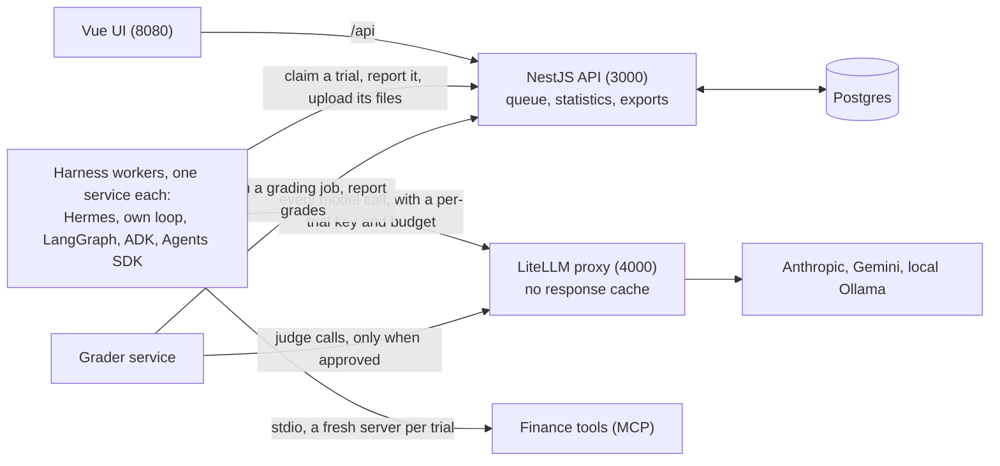

# Design

My design record for the platform: the six topics the brief asks for, one section each.

Each entry is one of three kinds:

- **Decided:** my call, with the decision (`docs/decisions.md`) or ruling it comes from.
- **Constraint:** a verified fact the design has to respect, with the evidence. Not a choice.
- **Open:** not decided yet. Options and tradeoffs live in `docs/decisions.md`.

## At a glance



**A trial's life.** A config is harness × model × settings × prompt × toolset, content-hashed. An experiment freezes two configs (or one, twice, for an A/A run), the tasks' hashes and N, and queues one trial per config, task and repeat. A worker claims a trial and gets its spec and a LiteLLM key capped for that trial. The shared adapter library runs the harness in a fresh folder on an internal network: the conversation (a simulated client for multi-turn tasks), the timeout and the trace. The worker uploads `result.json`, `trace.jsonl` (OpenTelemetry spans, the model calls taken from LiteLLM's own records) and `checks.json` (which figures have a source). The grader service then grades the trial as its own step, so a grader fix never re-runs a trial. The API compares the arms: a verdict, intervals, per-task flags, the A/A line, cost and time, and a cause for every failure.

**A harness is an adapter: two methods** on the shared library (section 2, `docs/adapter-contract.md`):

```python
class MyHarness(Adapter):
    def setup(self, ctx): ...                            # map our settings to the harness's own
    def run_turn(self, ctx, history, max_steps): ...     # one agent turn -> TurnResult
```

A model is one entry in LiteLLM's config (README, Add a model).

**The main entities** (section 3):

| Entity | What it is |
| --- | --- |
| Task | `tasks/<id>/task.json`: the messages or a simulated client, the client's file, the graders. Content-hashed; a change is a new version |
| Config | Harness × model × settings × prompt × toolset, content-hashed and insert-only |
| Experiment | Its frozen configs, task hashes, N, plan commit and platform commit; arms A and B |
| Trial | One attempt of one config, task and repeat, with its folder of result, trace and checks |
| Span | One step of a trial: a model call (from LiteLLM), a tool call, a turn, memory and skill events |
| Grading job and grade | One grading of a trial; every grade is versioned and never overwritten |
| Label | A human's judgment of one trial and criterion, with its rater (`labels/*.jsonl`) |

## 1. Architecture

Decided:

- The control plane is a NestJS API and a Vue 3 UI, in TypeScript (brief).
- Harness workers may be Python (spec).
- Every model call from every harness goes through LiteLLM (Rishi, 3 Nov). This one choke point is where settings, spend and usage are checked, whichever harness made the call.
- The model providers are Claude and Gemini (D4), both run as agents through LiteLLM (Gemini 3.8 Flash on the own loop and Hermes, 5 Nov). The open-weight route is a local demo (D5): Qwen2.5 7B on Ollama, an optional compose profile (`local-model`), priced at 0. It ran end to end on 5 Nov (`e_0mw3gbt9d38648a872d3c4b8b`, own loop, 2 tasks x 1): on the EMI task Qwen called `calculate_emi` with the right arguments and passed every check; on the distress task it answered without the helpline and failed. The local Qwen refuses `parallel_tool_calls`, so it is in the per-model table of refused settings (D25) and the field is never sent to it.
- LiteLLM's response cache is never on for trials. It would replay answers, so repeated trials would stop being independent samples (`CLAUDE.md`).

- Graders are Python (D1). The comparison's statistics run in the API, in TypeScript (D1 as amended, 5 Nov); the judge-agreement maths is Python (`stats/`).
- Workers talk only to the NestJS API, over HTTP: they claim a trial, then report its result. They never hold database credentials, so the API is the one owner of the schema and the one place that logs and checks what workers do (D2).
- Each harness runs as its own long-lived compose service, with a fresh process per trial (D3, section 4).

## 2. Harness and model adapter interfaces

Decided:

- **The harnesses are Hermes, the own plain loop, LangGraph, Google ADK and the OpenAI Agents SDK** (R1, R5, D11).
- **Build order and gates** (R7):
  - Hermes and the own loop come first, until one task runs end to end through both.
  - The other three are then built in parallel.
  - Each one counts only after it passes the settings test and the tool test.
  - The deadline for each one is Thursday 5 Nov, 12:00. A harness that misses it is cut on its own. Cut order: the two SDKs first, LangGraph last, never the own loop.
- **Adding a harness is an adapter, not a core change** (R2). The test cases are adding a GitHub coding agent or the Claude Agent SDK tomorrow. Until its author fills `version` in the capabilities file, which `make new-harness` writes as `TODO`, the catalogue leaves the new harness out and the API refuses configs and experiments for it (5 Nov, review A2), since no worker would claim its trials.
- **A new model is one config line**, because all model access goes through LiteLLM (SP1 done-when).
- **Task tools come from one MCP server shared by every harness** (D14), so every harness sees the same tool names, descriptions and schemas. It is started per trial over stdio inside the harness container, so its state lives in the trial folder. A toolset version is the list of the server's tools a config allows (`allowed_tools`), carried in the spec; each adapter filters the server's tools to it. Since 5 Nov the toolset is `finance/v3`: the 11 finance tools, 7 arithmetic tools (`add`, `subtract`, `multiply`, `divide`, `percent_of`, `percent_change`, `round`), so every figure in an answer can come from a tool and the agent never does its own sums (D54), and `reference_rates`, documented Indian market assumptions approved by Rishi (FD, savings, PPF, CPI inflation, repo rate, a long-run equity return) each with its source and date, so a rate the agent volunteers has a source too (D58). `finance/v2` (without `reference_rates`) replaced `finance/all`, and v3 replaced v2, each as a new version; a change to the tools, or to a reference rate's value, is never an edit of a version in place. A second built-in toolset, `finance-no-calculators/v3` (D70), is listed after it for the positive control only: the same server and version without the eight calculators, marked `validation_only` in `GET /toolsets` so neither the builder nor a new config picks it (A46).
- **Self-improvement is explicit** (R3). Anything that lets an agent change its own prompt, skills or memory in the background is a config setting, off unless a config turns it on.

Constraints:

- **The harnesses cannot share one Python environment.** Hermes pins `mcp==2.3.0` and `openai==2.54.0`. `langchain-mcp-adapters` 0.3.2 needs `mcp<2`. `openai-agents` 0.24.0 needs `openai>=3`, while `google-adk[extensions]` 2.13.0 needs `openai<3` (the 3 Nov resolve check; the ADK worker is pinned at 2.12.0). Checked 3 Nov with a resolve-only `uv pip compile`.
- **So each harness has its own environment, and the adapter boundary is a process boundary.** The platform hands a trial to a harness process and reads back the answer, the trace and the usage. That contract is `docs/adapter-contract.md` (contract v2): a trial spec in, a result, an OpenTelemetry trace and a runner report out.
- **Hermes runs only on Python 3.14.** Its lockfile supports `python_version >= '3.14'` only.
- **Hermes must be configured per process, before it is imported.** A bare `import run_agent` builds a full home folder under `HERMES_HOME`, so the home cannot be switched inside one process. Measured 3 Nov.
- **Hermes changes requests in ways the adapter has to neutralise.** `gpt-5*` model names route to the Responses API. Temperature only reaches the request through `request_overrides`. A `max_iterations` stop makes one extra, uncounted summary call. Details are in `docs/hermes-notes.md`.

Decided, the adapter rules (R10, 3 Nov):

- **One process, one file in, two files out.** A fresh adapter process per trial reads `spec.json` and writes `result.json` and `trace.jsonl`. Any language can implement it.
- **Adapters translate, graders judge, the runner labels.** The end-state list is provisional; raw harness stop signals are stored so trials can be relabelled later without re-running.
- **Models only through LiteLLM**, with a per-trial key; no provider keys and no internet in workers.
- **Declared and proven settings.** Each adapter declares the settings it supports; anything else is rejected before the run. A setting counts only once the settings test sees it in the captured request; tools must pass the tool test.
- **Native limits, sized runs, safety nets.** Limits go into each harness natively (the wrapper adds what is missing, such as a whole-trial timeout). Runs are sized upfront from the cost, time and N estimate. The runner's process-group kill and the proxy's spend cap are safety nets only.
- **Only the task's tools,** plus anything the config enables. **Nothing learns** unless the config says so (R3).
- **The proxy is the source of truth** for tokens, cost, latency and call counts.
- **Retries:** LiteLLM retries failed model calls with backoff (429, 5xx and timeouts, up to 3 times; never other 4xx), counted per trial as `proxy_usage.attempts` against the harness's `model_calls`; a trial that still fails is re-run by the runner, capped (D16). **One step is one model call** (D17). **Tool errors go back to the model** wherever the framework allows (D18). **Parallel tool calls** are a setting, off by default (D19). **Harness-added prompt text is kept and recorded** (D20).
- **Traces:** OpenTelemetry spans in OTLP JSON, one trace per trial, with `gen_ai.*` attributes and our own `evals.*` events for memory, skills and errors; model-call spans from LiteLLM's records, tool and turn spans from each adapter (D12, amended 3 Nov).
- **Thin adapters, no hidden retries.** One folder per harness; every harness's built-in retries set to zero so retrying happens in one place.

Decided, the field-by-field contract (R12, 3 Nov; to be iterated on 4 Nov):

- **`docs/adapter-contract.md` v2** defines the trial folder, `spec.json`, `capabilities.json`, `result.json`, the span names, exit codes, gate tests, effect checks, the simulated client and what is stored. The JSON Schemas in `contract/v2/` are its machine-readable form.
- **The config shape** is a common `settings` block (temperature, max output tokens, max steps, timeout, parallel tool calls, memory, skills, compression) plus `harness_options` validated against each adapter's own schema (D23).
- **Platform checks after every trial** (4 Nov, from Rishi's review): the runner writes `checks.json` next to the result, the same for every harness: number provenance (each money amount the agent wrote, and whether a tool result, the client file or a user message holds it at the precision shown; since D56, 5 Nov, an arithmetic tool's result counts only when every number it was given is itself supported, traced through the calls in start order, so `round(x)` or `add([x, 0])` on a made-up x is still unsupported; since D58 an input that is a unit fact (7, 12, 28 to 31, 52, 100, 365, 366, a lakh, a crore) needs no source, and a result that only repeats an input with no source never counts; since D61 numbers are verified, not traced: a figure no source holds counts when the checker recomputes it as a one-step derivation of numbers the answer shows, with at least one sourced amount, recorded as `derived_in_prose`, and the comparison reports how many figures each arm wrote without a tool, as a measure beside the pass rate, not a gate) and the task's `required_tools` called or missing. Graders and the judge read it; it never changes a trial's label (contract section 12).

Decided (D15, 5 Nov): compression, memory and skills off in both arms of the headline experiment; prompt-cache markers off (D31); Tool Search off (R10.7).

## 3. Data model

Tasks, configs, experiments, trials and traces.

Approved on 4 Nov (R14): `docs/proposals/data-model.md`. Content-addressed prompts, toolsets (since 4 Nov the toolset hash covers the published tool manifest and the server version, not just the tool names), tasks and configs; experiments freeze task hashes × config hashes × N; one trial row per (experiment, task, config, repeat, attempt) with a claim, heartbeat and idempotent report; spans and grades in their own tables; labels stay files; raw trial files stay under `runs/`.

Added with D22's reply cache (migration `002_sim_replies.sql`): a `sim_replies` table keyed by the simulator cache key, with the task sha256, simulator model, temperature, token cap and prompt sha256 it is scoped by and the trial that first produced each reply. A claim hands out every reply in its trial's scope; a report adds the trial's new ones, first reply per key kept. An empty reply is never cached (D26, 4 Nov): the adapter marks it with `error` in `sim_replies.jsonl`, the report skips it, and a claim leaves out any empty reply stored before that rule, so a trial re-queued after `infra:sim_error` asks the simulator again.

Added with D26 (migration `003_experiment_pause.sql`): an experiment status `paused`, with `paused_at`, `paused_reason` and `resumed_at`. A report labelled `infra:config_error` pauses a running experiment, so no more trials are claimed; `POST /experiments/:id/start` resumes it. `infra:config_error` and `infra:budget_net` attempts are never re-queued; the other infra labels are re-queued once (D16). Since D37 (migration 005), a config error pauses only its arm; the experiment status `paused` is for pauses by hand and D32's futility check and guards.

Added with D27 (migration `004_sim_temperature_optional.sql`): `sim_replies.temperature` may be null, for a simulator that sends no temperature (Haiku 5.5); claims select replies with `IS NOT DISTINCT FROM`, so a null temperature is its own cache scope. The spec's `client_sim` gains an optional `client_summary`, built by the API from the task's client file at claim time and not stored separately.

Added with D32, D34, D35, D37 and the guide review's platform item 8 (migration `005_run_controls.sql`):
- `configs.parent_hash` and `experiments.parent_experiment_id` (D34). Lineage is not behaviour, so it is not in the config hash. `experiments.reuse_baseline` asks to reuse the parent's arm-A trials; `baseline_decision` says whether that applied and why.
- `experiment_arms`, one row per arm (A, and B unless it is a pilot; D35): what can change while the experiment runs, kept off the frozen `experiments` row. An arm is paused by an `infra:config_error` report (D37, amending D26) or by hand; claims skip a paused arm. `reused_trial_ids` lists the parent's trials arm A reuses. `futility_checked_at` makes the futility check run once per arm.
- `trials.order_index` and `experiments.order_seed` (D32): a seeded shuffle of the (task, repeat) blocks, with the arm order shuffled inside each block, so the arms alternate and any early batch is a random sample. Claims go in that order.
- `experiments.futility` (the resolved rule) and `spend_guard_at` (the spend guard pauses once).
- `experiment_events`: pauses, resumes, stops and the baseline decision, which the trial rows cannot show. Claim, failure and re-queue events are still derived from the trial rows.
- `workers`: each worker's harness and when it was last seen (a claim, empty or not, or a heartbeat), so the estimate's time divides by the live workers per harness.

Added with D33 and D38 (migration `006_probes_and_system_spend.sql`; 005 is the run-controls work):

- **Probe trials.** `trials.experiment_id` may be null, and a `probe` flag marks a trial run outside any experiment to render a config's system prompt on the fake model (a check constraint ties the two). At most one live probe per config (a partial unique index). Probes are claimed through the normal worker protocol, ahead of experiment trials, and left out of estimates, the label queue and trial spend. They run a built-in task row, `prompt-probe`, that is not in the task catalogue.
- **`rendered_prompts`**, one row per config hash: the normalised system text, its sha256, the tool names, our prompt's offsets and the harness's own text, from the config's first usable probe.
- **`system_spend`**, one row per model call the platform makes itself: kind, model, status (`pending` with a worst-case reservation before the call, then `done` or `failed`), cost and tokens from LiteLLM's spend log, and a `ref` to what it was for. Allowances are computed from it.
- **`conflict_checks`**: findings cached by (input sha256, checker prompt sha256, model), where the input hashes the rendered prompt, our prompt and the settings, with the spend row that paid for them.

Added with SP4's grading step (migration `007_grading.sql`; R14 "grading is its own step"): a `grading_jobs` table, one row per grading of one trial, holding the frozen grader specs with their hashes, any grader files, a claim lease and the task's outcome on that trial (pass, fail or incomplete); and `grades` gains the grader type, `required`, the reason, the spec hash, the framework version and the job. A grade is unique by (trial, grader id, grader version, run index), so a re-grade adds rows and never overwrites one. Views `current_grading` and `current_grades` give each trial's latest finished grading.

Added with the LLM judge's approval (SP4, R8; migration `010_judge.sql`): `judge_approvals`, one row per approval of real-model judging for one experiment, with the judge model, the budget, the LiteLLM key minted for it and when it was approved and revoked. At most one is active per experiment (a partial unique index). The key is limited to the model and capped at the budget, and sits outside the experiment's team, so judge spend is its own line and never uses the trials' budget. The grading claim hands it to the grader worker while the approval is active.

Added with D72 (migration `016_regrade_experiment.sql`, 5 Nov): `grading_jobs.regrade_experiment_id`, the experiment whose regrade queued the job (null for a first grading). A regrade also covers the trials arm A reuses from a parent (D34), which belong to the parent; the claim hands out the judge approval of this experiment, else of the trial's own, so a reused trial is judged under the regrading experiment's approval and budget. No foreign key, so an exported example may name an experiment it does not ship. `grades.judge_model` (in the table since 001) is written since D72 too: the model a judge grade called, from its `judge_call` evidence.

Added with D73 (migration `017_label_rater.sql`, 5 Nov): `labels.rater`, the id of the person who gave the label (1 to 40 lower-case letters, digits, dashes or underscores, checked by the table). More than one human labels now: Rishi and the raters he names. Every line `POST /labels` appends to `labels/<set>.jsonl` carries `"rater"`; a line without one was written before D73 and is imported as `rishi`'s, and the rows stored before the migration became `rishi`'s too. The column has no default, so a label never becomes Rishi's by accident. The files stay the source (R14). `GET /labels/queue?rater=` works out what that rater has labelled, marked "unsure" and settled from their rows alone, so each rater has their own queue and second looks; D52's rule that a trial labelled in one set is in no other set still reads every rater's labels. The failure causes (section on D64) read only `rishi`'s labels, as before.

Added with D39's seeded runs (migration `008_config_seed.sql`): `configs.seed`, the memory entries and skills every trial of the config starts with, in contract v2's seed shape; older configs get empty lists. A non-empty seed is part of the config hash, and an empty one is left out of it, so configs made before seeds keep their hashes. The claim copies it into `spec.seed`. `POST /configs` refuses a seed for a feature the harness cannot take or the config turns off (`docs/api-contract.md`).

Added for shipped example data (SP7; migration `011_examples.sql`), so a reviewer can open a solved experiment without spending anything: `experiments.example_name`, `example_title` and `example_loaded_at` mark an experiment loaded from `examples/<name>/`, and a check keeps such a row `done` or `cancelled`. An example is a finished experiment exported with `scripts/export_example.py` through the read-only `GET /experiments/:id/bundle`: every row it needs (its configs and their parents, prompts, toolsets, tasks, arms, stored events, trials, spans by their raw OTLP JSON, grading jobs and every grade version) in `rows.json.gz`, and each trial's stored files in `files.jsonl.gz`, both gzipped and checked by sha256 in `manifest.json`, with key tokens, Authorization values, the worker token and the master key scrubbed and a check that fails the export if any survives. `POST /examples/:name/load` only inserts: the same ids (except new ids for grades and stored events), each file under the trial's `runs/` folder without replacing one, a second load is a no-op, and an id or file already here with other content is a 409. Content-addressed rows are shared with your own when the content is the same. The loaded experiment stays apart from your own work: run controls, regrade and judge approval refuse it, nothing claims or queues grading for it, and its trials are left out of spend, estimates and the labelling queue (`docs/api-contract.md`, Shipped examples). Since 5 Nov a config read also says whether it is `example_only` (worked out on read, no column: an example uses it and none of your own experiments does), so the UI never starts a new config or a run from one by default (A31). Since 5 Nov the UI's `#/example` loads the first shipped example by name and its companions (examples whose name starts with the first one's, here the headline's A/A calibration) before it opens the first one's comparison, so that comparison finds its A/A line; it then loads the other examples (the positive control and the two replications) in the background. The A/A lookup stays on its own side: an example reads only shipped calibrations, your own experiment only your own.

Changed after the second fresh-clone QA (5 Nov), no migration: the API is told whether each provider key is set (compose passes `ANTHROPIC_KEY_SET: ${ANTHROPIC_API_KEY:+1}` and the Gemini one, a flag and never the key, which stays LiteLLM's alone; `scripts/check_compose.py` enforces both), so `GET /models` carries `key_set` and the UI holds a run back before its first call fails. A `fake/*` model is a script: its trials are not labelling items, and its made-up prices are kept out of `GET /spend`'s trial spend (`fake_trials_usd`, A32). The export's grade columns and `outcome` are each trial's current grading, as the comparison counts it; older grade versions stay in the database and the bundle.

Changed after the third fresh-clone QA (5 Nov), no migration: both exports carry `experiment_title`, the name screens show (a shipped example's manifest title, else the experiment's name), so an example's stored working name is never the only one a reader sees. `POST /experiments` caps a name at 200 characters, and the judge's approval refuses a model whose provider key is known not to be set. In the UI, one rule says what two configs differ in, with both values (`armDifferences` in `apps/ui/src/lib/arms.ts`, A35), and one names arms by it (`armsOf`): the comparison's header, the Run screen's arm labels, checks and default run name, the builder's "Evaluate it" and a config's compare-with-parent all read them (`apps/ui/src/lib/checks.ts` only phrases the entries); config auto-names are made from the config's content (A36).

Added for A/A calibration (D44; migration `012_calibration.sql`): `experiments.calibration` marks a run that puts one config on both arms, and a check keeps it true exactly when `config_hashes` names one config twice. An arm is now keyed by (experiment, arm letter), no longer (experiment, config), since both arms of a calibration hold the same config. A calibration's arm B trials are repeats n to 2n - 1, which is how arm counts, pauses, the futility check, the spend guard, claims, events, the export and the comparison tell the arms apart (`TRIAL_IN_ARM` in `apps/api/src/experiments/run-state.ts`). The comparison's statistics (section 6) are computed on read and cached in memory, not stored: they are a function of the trials and their current grading.

Added for the platform commit (review G2, 5 Nov; migration `014_platform_commit_source.sql`): `experiments.platform_commit_source`, `env` when `platform_commit` is `EVALS_PLATFORM_COMMIT` as set, `git` when the API read it from the checkout's HEAD. Compose mounts the repo's `.git` read-only into the API, which reads HEAD and the ref it names (a loose file or `packed-refs`, `apps/api/src/common/git-commit.ts`) each time an experiment is created, so a plain `docker compose up` records the commit; before, it was null unless someone pasted `git rev-parse HEAD` into `.env`. Either source leaves the working tree unknown-dirty.

Added for abandoned attempts' spend (review G3, 5 Nov; migration `015_abandoned_spend.sql`): an attempt whose lease lapses never reports, so the lease sweep reads its keys' spend from LiteLLM's spend log before revoking them and writes `cost_usd`, `sim_cost_usd` and the agent key's tokens and calls on the abandoned row, as a report would; every spend total (`GET /spend`, an experiment's spend, the spend guard, the export) already sums those columns. `trials.spend_unknown` marks an attempt whose log LiteLLM could not give: its costs stay null, unknown and not zero, and `GET /spend` counts such attempts (`trials_spend_unknown`). The migration marks attempts abandoned before it, whose spend was never read. The spend guard and `actual.cost_per_trial_usd` count an abandoned attempt's spend as spent but not as a reported trial.

Storage: experiment trials, their spans, grading jobs, grades, labels and events live in Postgres; each trial's files (result, trace, checks, proxy logs) are stored by the API under `runs/<experiment>/<trial>/attempt-<n>/`, uploaded by the worker with a sha256 per file. A folder store (`FileTrialStore`) remains only for gate and smoke runs recorded outside an experiment.

## 4. How runs are isolated and reproduced

Constraints:

- **Hermes is pinned at `6112c2adb9e11f69734a29be9d2696f345ffa06a`** and installed from its own `uv.lock`. Hermes source is never modified.
- **Each trial needs its own Hermes home, set before import.** See section 2.
- **The Hermes home path appears in the system prompt**, so its path must be the same in every trial. Otherwise two configs differ by more than their axis.
- **Hermes can edit its own `config.yaml`, `SOUL.md` and `AGENTS.md` with no switch to stop it.** Those files need a hash check before and after every trial (R3).

Decided (D3; Rishi delegated the call to "simpler and more robust"):

- **One long-lived container per harness, a fresh process per trial, one trial at a time per container.** Each harness is a compose service with its own image. Parallelism comes from running more replicas of a service.
- **Every writable path lives in one trial folder at a fixed path.** That covers the Hermes home, `HOME`, `TMPDIR` and tool state such as the finance ledger. Because only one trial runs in a container at a time, the paths are the same in every trial, so prompts that carry them stay identical.
- **Between trials, the runner kills every leftover process, wipes the folder and checks it is empty.** Hermes's scratch-prune child deliberately outlives its parent, which is why the sweep is needed.
- **The root filesystem is read-only**, so nothing can persist outside the trial folder.
- **Workers mount nothing from the host.** After a trial the worker uploads each file of `out/` to the API (`PUT /api/worker/trials/:id/files/*path` with its sha256), and the API alone writes `runs/<experiment>/<trial>/attempt-<n>/`. A trial therefore cannot read or change an earlier trial's stored files (D2, D3; `docs/api-contract.md`, worker protocol).
- **The API writes the host's folders as uid 1000, whoever owns them** (5 Nov, the clean-machine test; Rishi: "fix in the container"). The API mounts `runs/`, `labels/` and `configs/prompts/` read-write from the clone, which belong to the host user; where that user is not uid 1000 the API could not write them. Its image now starts as root only for `apps/api/docker-entrypoint.sh`: for each of the three folders that uid 1000 does not own (or cannot write), it gives that folder alone, never its contents, to uid 1000, keeps its group and adds `g+rwxs`, then runs the server as uid 1000 with `setpriv` (umask 002, the folders' groups as supplementary groups, no capabilities, no new privileges). So what the API writes belongs to the host user's group and is group-writable, and the host user deletes it without sudo. Workers and the grader mount nothing and are unchanged. `GET /api/health` is 503 with a plain-words `files_problem` when a folder stays unwritable, so `docker compose up --wait` fails.
- **A worker crash kills its own trial.** The trial's claim then lapses and it is re-run once, never twice.
- **Each trial gets its own LiteLLM virtual key and budget**, since the key is readable inside the container.

Reproduction: what pins a past result

- **Everything a trial ran on is content-addressed.** A config's hash covers the harness and its pinned SHA (Hermes `6112c2a`), the adapter version and capabilities file, the model name, the prompt's sha256, the toolset's sha256 (every tool's name, description and schema plus the finance server's version), the settings and harness options, and any seed. Prompts, toolsets and tasks are stored as versioned rows by hash; an edit is a new version, never a change in place.
- **An experiment freezes its inputs.** It stores the config hashes, the task sha256s, N, the simulated client's model and prompt, the claim-order seed, the analysis-plan commit and the platform commit with where it came from (section 3); its trials keep the task version they ran on.
- **Grades are versioned, never overwritten.** A grader's version is the hash of its spec and the framework version; a regrade adds new grade rows from the recorded trial files and re-runs nothing (R14), so an old result can be re-scored with new graders, or read as it was.
- **The model side is recorded, not just requested.** LiteLLM logs every call per trial key; the platform keeps each request and response under `artifacts/proxy/`, and no response cache is ever on, so a re-run is a new sample, not a replay. What cannot be pinned: the provider's model behind a model name (`claude-haiku-5-5`) can change on the provider's side (`docs/known-limits.md`).
- **The statistics are deterministic.** The bootstrap and the sign-flip test are seeded from the experiment id, so the same trials and grades give the same interval and verdict.

Given up: consecutive trials in one container are separated by the sweep, the wipe and the read-only root, not by a fresh container. The SP3 leak test checks this. See the D3 entry in `docs/decisions.md` for the full tradeoff.

## 5. Grader design and validation

Decided:

- **The domain is a personal-finance assistant** (D13, R6).
  - Every task needs a correct tool call and a response that fits the person's circumstances.
  - Rishi's example: debt taken on after a spouse's death should get a different answer from a loan for a phone bought because friends had one.

Built on 4 Nov, where graders live (follows D1, D2, R10.2 and R14; the SPEC left the project's place to SP4):

- **Graders are a Python project at the repo root, `graders/` (package `evals_graders`)**, outside every harness worker: adapters only report how a trial ended (R10.2), graders judge.
- **A task's graders are checked before any trial runs** (5 Nov, review A5): the API checks every entry of a task's `graders` against the grader framework's own schema (`graders/src/evals_graders/grader-spec.schema.json`, the one source; the API image copies it, the grader image holds it as package data) and for duplicate ids, when it loads the task. A task that fails is listed in `GET /tasks` with its problems and cannot go into an experiment, so a typo is no longer an `error` grade on a trial already paid for. What only the grader can check stays at grading time: a Python regex that will not compile, a missing `unit_test` file or rubric.
- **A grader reads only the trial's stored files:** `result.json` (final answer, transcript, end state), the `execute_tool` spans in `trace.jsonl` (tool names, arguments, results, with Hermes's `mcp__finance__` prefix and wrapped results normalised) and `checks.json`. `evals-grade <out_dir> --task task.json` grades one folder from the command line.
- **Grading is its own step after the trial (R14).** A `grader` compose service (`evals-grader`, same read-only runtime as a harness worker, trials network only, no mounts) claims grading jobs from the API, downloads the trial's files over HTTP, grades and reports (D2). A grader fix is `POST /experiments/:id/regrade`: new grade versions next to the old ones, no trial re-run (`docs/api-contract.md`, Grading). Since D72 it also covers the trials arm A reuses from a parent, judged under this experiment's approval.
- **Every grade quotes its evidence verbatim** and carries a version: the hash of its spec (and grader file) plus the framework version, computed identically in Python and in the API. A judge's rubric file (`configs/rubrics/<id>.<version>.md`) is part of its version the same way, so editing a rubric gives new grade versions.
- **Judging runs only with an approval per experiment (R8).** `POST /experiments/:id/judge` names the judge model and a budget (at most $20); the API, which alone holds LiteLLM's master key, mints one key for it, limited to that model and capped at that budget, and the grading claim carries it (`judge: {base_url, api_key, model}`) while the approval is active. Without one the claim carries `judge: null` and the judge grader answers `not_implemented`. `GET /spend` shows judge spend as its own line, from LiteLLM's spend log.

- **The judge is plumbing around Rishi's rubric** (4 Nov night): it runs in the same grader worker, calls a model only with the per-experiment key the API mints when judging is approved with a model and a budget (R8), sees only what the blind labelling screen shows plus any reference facts, answers yes or no with a quote per criterion, and every quote is looked up in the material. The rubric file is part of the grader version. Details and the open choices: `docs/proposals/grader-format.md`, The judge.

Built in SP4: the grader spec format, its ten types (number, tool_called, tool_not_called, regex_present, regex_absent, end_state, provenance, required_tools, unit_test, and the judge; provenance and required_tools read the runner's `checks.json`) and the outcome rule are in `docs/proposals/grader-format.md`, with the choices listed there.

Decided, the judge's trust bar (D8, 5 Nov): a judge criterion counts in the headline only when, on the held-out labels, kappa >= 0.6 with its 95% interval's lower end >= 0.4, there is no false-pass gap between arms, and test-retest agreement is >= 90%. Below the bar it stays visible in trials and the report. Rubric v1 stayed as committed after the tuning check (D69).

Every task has a judge grader on the rubric `configs/rubrics/advice.v1.md` (D68), and every judge criterion is optional until it is trusted (D8). Which criteria become required once trusted is still open (D7).

The agreement arithmetic is a Python project at the repo root, `stats/` (package `evals_stats`, standard library only, D1); SP6's comparison runs in the API instead (section 6). It reads labels from `labels/` and grades from the API, and calls no model.

Validated so far (5 Nov):

- **Deterministic graders: by tests and by reading real trials.** `graders/tests` runs every task's graders on a trial that does the task well and on one that shows the failure the task exposes (`test_task_graders.py`), the provenance and required-tools graders on real `checks.json` files from gate runs (`test_gate_checks.py`), and the graders on the real 4 Nov transcripts (`test_real_trials.py`). Reading trials found false fails: two regexes fixed in task version 2 (D53), and one in `draft-mba-loan-missing-info` and the rate-fraction case in provenance kept as findings under the freeze (`docs/known-limits.md`). There is no human-label check of the deterministic graders as a whole.
- **The judge, on Rishi's tuning labels only** (Gemini 3.8 Flash, rubric `advice.v1`, 33 discovery trials, one rater; `docs/experiment.md`, "The judge against Rishi's tuning labels"). The specific criteria agreed: clears-card-first 12 of 12, keeps-medicines 3 of 3, health-cover 3 of 3 (kappa undefined: his labels were all one value). The overall criterion is lenient: kappa 0.30 (95% interval 0.00 to 0.78), sensitivity 1.00, specificity 0.20, 4 false passes, 3 of them payoff-order trials he failed for assuming what ₹20,000 meant, which `clarifies-ambiguous-amount` caught 3 of 3. So the criteria are scored and reported separately.
- **Not yet validated:** agreement on the held-out labels, the false-pass gap between arms, and so the trust bar above. Until then no judge criterion counts in the headline: every judge check in the held-out tasks is optional, and the headline run was graded without the judge.
- Judge retest: see `docs/experiment.md`.

The plan and the label sets are in `docs/judge-validation.md`; results so far are in `docs/experiment.md`.

## 6. Statistical method and choice of N

The question is always "is B better than A, and how sure are we". The comparison answers it in
`GET /experiments/:id/compare` (`stats`), computed in `apps/api/src/stats/`: pure, seeded
TypeScript functions, tested against published values and on simulated data with a known truth.

Decided (D10 as revised 5 Nov, D41, D42, D43, D44, D50; the proposal is `docs/proposals/stats.md`):

- **Where it runs.** In the API, in TypeScript: the brief requires TypeScript for the API, and the
  comparison is an API response. D1's Python covers the graders and the judge-agreement arithmetic
  (`stats/`), not this.
- **The task is the unit.** Per task and arm, pass rate = trials that passed / trials decided (pass
  or fail). A trial with no outcome (a required check gave no verdict, such as the unapproved
  judge) is left out and counted, never a pass or a fail. A task where an arm has no decided trial
  is left out of the aggregate and listed with why. Why the task and not the trial: the 10 trials
  of one task share that task's difficulty, so counting 2 x N x K trials as independent overstates
  how sure we are. We want to say something about "tasks like these".
- **The headline** is the mean over tasks of d(t) = rate_B(t) - rate_A(t), each task weighted
  equally, in percentage points.
- **The interval: a task bootstrap.** 10,000 times: draw K tasks with replacement and take the mean
  of their observed d(t). The 2.5th and 97.5th percentiles of those means are the 95% interval.
  Why tasks only (D10 revised): each task's observed rate already carries its trial-to-trial noise,
  so resampling trials again inside each task counts that noise twice and makes the interval too
  wide (Davison and Hinkley 1997, section 3.8). Measured on simulated data at K = 20 tasks and N =
  10 trials: the two-level version (the first design) covered the truth 98.5 to 99% of the time,
  made false "better or worse" calls 1.5% of the time and found a real +15 points 69% of the time,
  with an interval 40% wider; tasks only covers 92 to 94%, makes 3.4 to 4.7% false calls and finds
  +15 85% of the time (`apps/api/src/stats/simulation.spec.ts` keeps both).
- **The paired test: sign flips.** If B made no difference, each task's d(t) is as likely to be
  positive as negative. Flipping signs in every one of the 2^K patterns gives the spread of means
  "no difference" would produce; p is the share at least as far from zero as the real one
  (two-sided). Exact up to 30 tasks (counted by splitting the tasks in two halves, no listing of
  2^K patterns), else 20,000 seeded flips. No normal-distribution assumption, and the pairing is
  by task. McNemar does not fit: it needs one trial per task and arm.
- **The verdict (D42, D43), in this order.** *Better*: the interval lies above 0 and p < 0.05.
  *Worse*: the interval lies below 0 and p < 0.05. *Practically equivalent*: the whole interval
  lies inside +/- 10 points. *No detectable difference*: anything else, always with "differences as
  large as X points are not ruled out" (X is the interval end furthest from 0). Equivalence is a
  claim about the whole interval: -2 points with an interval of -14 to +10 is not equivalent,
  because a 14-point drop is still possible.
- **Fewer than 6 tasks: no verdict but "no detectable difference" (D50).** With K tasks the
  smallest possible sign-flip p is 2/2^K, which is 0.0625 at 5 tasks, so better and worse are
  impossible below 6; the same floor keeps "equivalent" from resting on a bootstrap of so few
  tasks, which under-covers (84% at K = 4) and has no width at all with one task.
- **Per task (D41).** Each task's own difference gets Newcombe's interval for two independent
  proportions (it stays inside -100 to +100 and behaves at 0 of 5 or 5 of 5, where the textbook
  interval breaks) and Fisher's exact test. With 12 to 20 tasks at 5%, about one would look
  different by chance, so a task is flagged "beyond noise" only after Benjamini-Hochberg at q =
  0.05 across the tasks: among flagged tasks, at most about 5% are expected to be noise. A flag
  means "look here", not a verdict. Holm was rejected because at N = 5 to 10 trials it can never
  flag a task.
- **The critical-failure guardrail (D10).** Each grader may carry a severity (critical, major or
  minor) in its task file, set by Rishi; it never changes a verdict. Per task with a required
  critical check, the critical-failure rate is the share of decided trials where such a check
  failed; B minus A gets the same task bootstrap. B is never called better while that interval
  lies above 0: the verdict is then *held back* ("not called better: critical failures rose"),
  shown beside the verdict either way. With no check marked critical, the comparison says so
  rather than claim safety. The severity is read from the grader specs of the grading that
  produced each trial's grades (the task file it was graded with).
- **The regression list (D10).** Every task where B dropped (d(t) < 0), or where any check's own
  pass rate fell from A to B, whether or not it is beyond noise: counts, interval, flag, and the
  checks that got worse (pass rate in each arm, severity), critical first, with links to B's failed
  trials, each failed trial's cause, and the causes that grew from A to B on that task (D64, below).
- **Cost, tokens and time next to quality** (proposal section 8). The same task bootstrap on each
  task's mean cost per trial (LiteLLM's recorded cost of the agent's calls; the simulated client's
  cost is the environment's and left out), tokens (input plus output) and time, as a difference
  and a relative difference with intervals, and no verdict, so "v2 is better and costs 6% more"
  reads in one line. A fake model's prices are made up, and the screen says so.
- **Latency is not skewed by retry backoff.** LiteLLM
  retries a failed call with backoff (D16) and records it: each spend-log row's
  `attempted_retries`, which the runner reports as `proxy_usage.retried_calls` and puts on each
  model call's span as `evals.proxy.attempts`. A trial in which any model call was retried (the
  agent's or the simulated client's) is left out of the time comparison only, and counted per arm
  (`left_out_retried`); cost and tokens keep it, since a backoff wait costs nothing. A trial whose
  record does not say (recorded before 4 Nov, or with no LiteLLM record) is kept and counted
  (`retries_unknown`).
- **A/A calibration (D44).** A run marked as a calibration puts one config on both arms; arm B's
  trials are repeats n to 2n - 1, interleaved with arm A's in the seeded claim order, so it
  measures this setup's own noise, side effects included (claim order, shared workers). Its
  comparison says whether it came out "no detectable difference", as it should. Every ordinary A/B
  shows the latest finished calibration of either arm's config under its own interval, or says
  there is none and links to set one up. Without the mark, the same config twice is refused.
- **Repeatable and current.** Every random stream is seeded from the experiment id (sfc32 started
  from a sha256), one stream per use, so the same data always gives the same numbers. Results are
  cached by the trials and their current grading jobs, so a regrade recomputes them; while any
  trial's grading is still running there is no verdict, and the screen says why.
- **Both arms graded alike, or no verdict (D72, 5 Nov).** Rishi's case: arm A reused from a parent
  (D34) was judged under an older rubric than arm B, so the arms would be scored by different rules
  and the difference could be the rubric's, not the agent's. On each task, every grader's current
  grades over both arms' done trials must come from one grader version (the hash of its spec, the
  files it reads such as a judge's rubric or a unit test's grader.py, and the framework version)
  and, for a judge, one model (`grades.judge_model`, from the judge's own call record). A mix inside
  an arm (grading that spanned an edit) is not alike either, and a trial graded without a grader
  the others have counts as a version of its own. When a **required** grader differs, `stats` is
  null and `stats_note` names the graders and tasks (three by name, the rest counted) and says to
  regrade; the pass counts are still shown. An **optional** grader that differs cannot change a
  trial's outcome, so the verdict is given and the difference is reported (`grader_versions` in the
  comparison, and a line on the screen). The check runs after "grading still running" and before
  the analysis (`apps/api/src/stats/graded-alike.ts`, pure, with unit tests). A regrade covers the
  trials arm A reuses too, judged under the regrading experiment's approval, so one regrade brings
  both arms onto the current graders. The details and why: `docs/assumptions.md` A47.

Constraints:

- **With a two-sided exact paired test (sign-flip) across k tasks, the smallest possible p-value is
  2/2^k**, however many trials each task gets. At 5 tasks that is 0.0625.
- **Measured power and coverage** (simulated: task pass rates spread uniformly from 10% to 75%, B
  adding a fixed effect; 1,000 runs per row, 2,000 resamples each; `apps/api/src/stats/simulate.ts`):

  | Tasks K, trials N | A/A: false better or worse | Interval covers the truth (A/A, +15) | +15 called better (power) | Interval width |
  | --- | --- | --- | --- | --- |
  | 4, 10 | 0% (cannot, D50) | 84.0%, 83.1% | 0% | 31 points |
  | 6, 10 | 0.9% | 87.7%, 86.7% | 10.5% | 28 |
  | 8, 10 | 2.7% | 88.5%, 90.7% | 30.4% | 25 |
  | 10, 10 | 2.9% | 90.5%, 91.8% | 49.9% | 23 |
  | 12, 10 | 3.3% | 92.0%, 90.8% | 54.7% | 21 |
  | 20, 5 | 3.6% | 93.9%, 94.4% | 51.9% | 24 |
  | 20, 10 | 3.4% | 93.0%, 94.2% | 85.4% | 17 |
  | 40, 10 | 4.1% | 93.6%, 95.1% | 99.0% | 12.5 |

  The false-call rate stays under 5% because better and worse also need p < 0.05 from the exact
  test; the percentile interval covers a little under 95% with this few tasks.

Choice of N (decided 5 Nov, Rishi: "Approve both, N=10"; `docs/experiment.md`, "The final runs"):

- **N = 10 trials per task and arm, on K = 10 held-out tasks (D53)**, so 200 trials per A/B run.
  K was set by the task split (10 of the 21 tasks held out); N was chosen from the simulation
  table above and the cost, about $2 per 200 trials of Hermes on Claude Haiku 5.5 (expected
  $1.95; the headline run cost $2.295 and its A/A calibration $1.959, `docs/cost.md`).
- **What the table said beforehand. At K = 10 to 12 and N = 10, a real +15 point improvement is
  called "better" only about 50 to 55% of the time**; at K = 8, 30%. A "no detectable difference"
  at that size is weak evidence of no change. In this simulation more tasks help more than more
  trials: K = 20 lifts power to 85% at N = 10, while N = 5 at K = 20 gives 52%.
- **What happened.** 5 of the 10 held-out tasks tied (4 at 10 of 10 in both arms, 1 at 0 of 10).
  A tied task gives the sign-flip test nothing, so the effective K was 5 and the smallest
  reachable p was 2/2^5 = 0.0625: v2 was higher on all five tasks that could differ (+9 points,
  95% interval +3 to +16) and the verdict was still "no detectable difference" (`docs/experiment.md`,
  Results). The limit was the number of held-out tasks that are neither at ceiling nor at floor,
  not N; more such tasks would help more than more trials.
- **What the pilot already said (read after the run, so a lesson, not a change).** The v1
  discovery run is in effect the pilot: 11 discovery tasks x 3 trials (`e_0mw33tqo41489091e4da80c75`).
  4 tasks passed every trial and 2 failed every trial; 5 of 11 were in between. If about half the
  tasks sit at ceiling or floor, K = 10 leaves about 5 that can differ, and over 5 the sign-flip
  test cannot go below p = 0.0625: the headline's outcome was predictable from the pilot. The
  held-out tasks themselves had no pilot (the split keeps them unrun, D53), so the rule for next
  time is about K and difficulty, not about picking tasks: plan for at least 12 tasks that can
  differ, so K of about 24 at this ceiling rate, or harder tasks. (With 3 trials, a task at 3 of 3
  might be 9 of 10 at N = 10, so the pilot overstates the ceiling a little.)
- The pre-run estimate of the smallest difference a planned N and K can detect (proposal section
  6) is not built; the table above stands in for it.

### Failure causes and behaviour per arm (D64)

Decided (D64, Rishi, 5 Nov; the rules' details are A45 in `docs/assumptions.md`):

- **Every trial that failed, or ended other than `answered`, gets one primary cause and the other
  causes that also apply**, each with one plain sentence quoting the evidence ("calculate_emi was
  never called; amortization_schedule was"). They answer the brief's stretch item 7: a regression
  points to a cause. They explain the pass rate and never change the verdict.
- **Rule-based, from what each trial already recorded, and free.** No model reads a trial to
  name its cause and nothing is regraded: the rules read the end state and the harness's stop
  reason (`result.json`), the `execute_tool` spans, the current grading's grades (each grader's
  reason and evidence, which quote the runner's `checks.json` for provenance and required tools),
  the grader specs of that grading, the spec's limits and `required_tools`, and Rishi's labels
  (rater `rishi` only: since D73 other raters' labels are in the same table and are not read
  here, so one person's answer is never mixed with another's). A cause is computed on each read
  (`apps/api/src/causes/`), not stored, so a new label or a regrade
  shows at once, and the same trial always gets the same cause under the same `rules_version`.
  Free and repeatable mattered more than nuance: a judge model naming causes would cost per
  trial, vary between runs, and itself need validating against labels.
- **How each cause is decided, in the order the rules are tried** (the first match is primary):
  1. *Ran out of steps*: the end state is `step_limit`, `token_limit` or `timeout`.
  2. *Other, an error*: the end state is `agent_error` or `harness_error` (an agent outcome by the
     runner's label), with the harness's own stop reason quoted.
  3. *Judge vs label*: on a criterion Rishi labelled, the judge's verdict differs from his label;
     primary only when every failed required check is a judge check whose "no" criteria his
     labels pass, otherwise contributing.
  4. *Wrong tool*: a tool the task wants (its `required_tools`, or the tool of a required
     `tool_called` check) was never called and another tool was; or a `tool_not_called` check
     failed.
  5. *Gave up early*: it answered, a wanted tool was never called, and no other tool was called in
     its place (no tool at all, or only some of the wanted ones).
  6. *Made-up arguments*: a `tool_called` check failed because its tool was called but never with
     the arguments the check wants (the grade says "but 0 matched" and quotes the calls), or a
     provenance check failed on a figure that came from an arithmetic call the runner's checks
     rejected because an input had no source.
  7. *Tool error*: a tool returned an error and was never called successfully after it.
  8. *Unsupported figure*: the provenance check failed; the figures it quotes are named.
  9. *Wrong answer*: a required check on the answer (`number`, `regex_present`, `regex_absent`,
     `unit_test`) failed while every wanted tool was called.
  10. *Other*: none of the above; the failed checks are named with the first one's reason.
- **Harness-specific signals are said, not flattened**: one set of causes for every harness must
  not hide how each one fails. The reasons keep what differs by harness: Hermes answers at the step limit with a
  summary, the others stop without one; the own loop sends a cut-off reply again at double the cap
  before it ends `token_limit`; each harness passes a tool error back to the model its own way
  (Hermes as `{"error": ...}`, pausing the tools after three in a row, and runs a call it cannot
  repair with no arguments); LangGraph and ADK end `agent_error` on malformed calls; and the
  harness's own stop reason is quoted.
- **How each arm behaved**, on the comparison beside the pass rate: tool calls per trial in all
  and per tool, the share of trials that called each tool the task wants, tool errors per trial,
  steps (model calls, D17) per trial and step-limit hits, end states, figures written without a
  tool (D61) and the causes. Tool calls and steps per trial get B minus A per task with the costs'
  task bootstrap and no verdict, as costs do.
